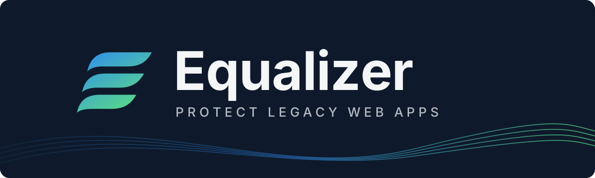
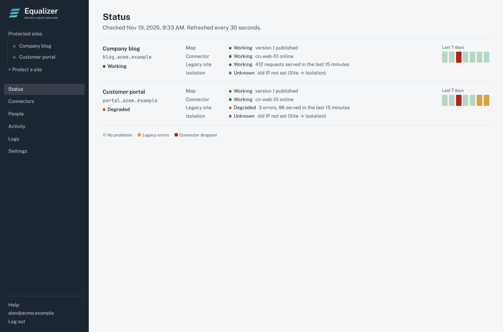
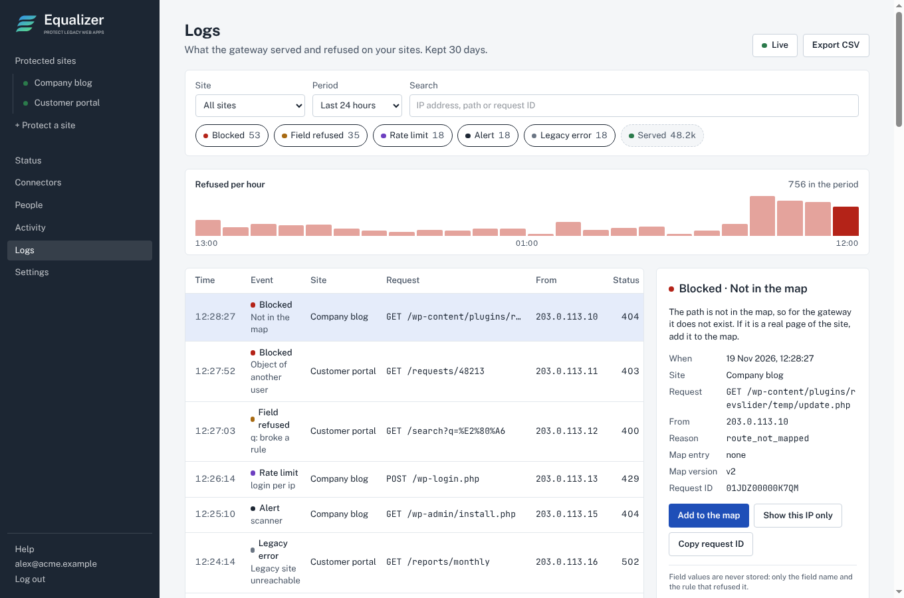
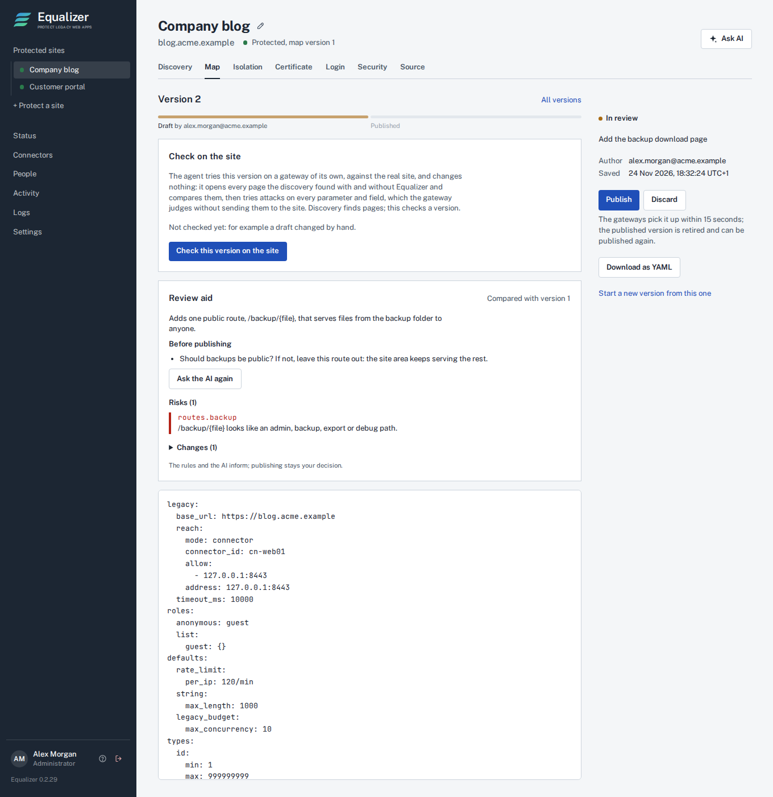
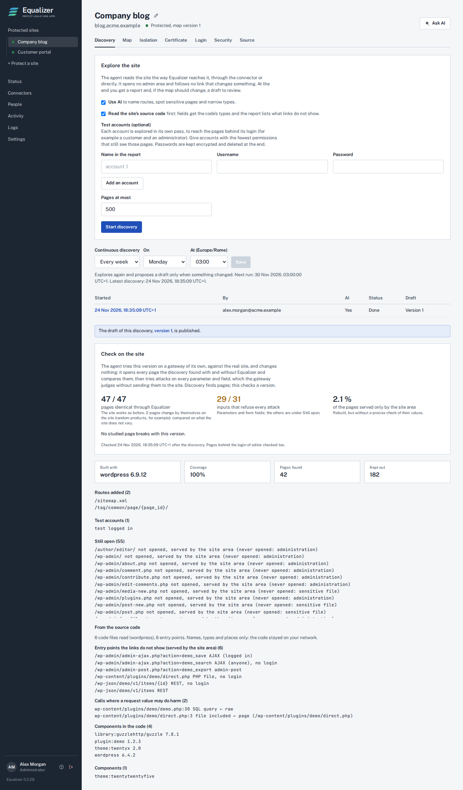
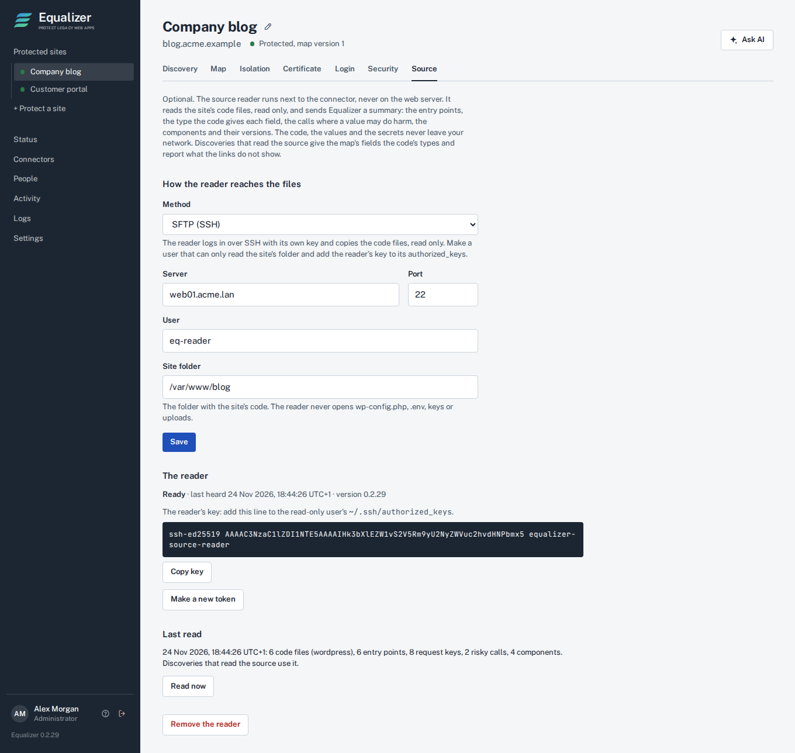
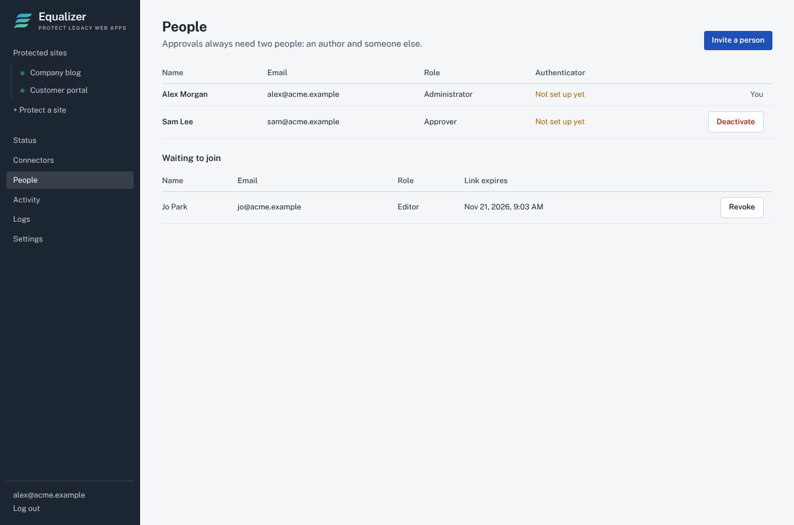

<p align="center"></p>

# Equalizer

Equalizer protects legacy web applications that cannot be updated. It hides
them from the Internet and serves an **identical copy**, rebuilt on every
request by a gateway: the signed map says what exists (by default the whole
site, admin included), and nothing reaches the legacy application as the
client wrote it.

> **Status:** prototype 0.2.31, installed on its first server (release
> notes in [`docs/releases/0.2.31.md`](docs/releases/0.2.31.md); the previous
> ones, [`0.2.30`](docs/releases/0.2.30.md), [`0.2.29`](docs/releases/0.2.29.md), [`0.2.28`](docs/releases/0.2.28.md), [`0.2.27`](docs/releases/0.2.27.md), [`0.2.26`](docs/releases/0.2.26.md), [`0.2.25`](docs/releases/0.2.25.md), [`0.2.24`](docs/releases/0.2.24.md), [`0.2.23`](docs/releases/0.2.23.md), [`0.2.22`](docs/releases/0.2.22.md), [`0.2.21`](docs/releases/0.2.21.md), [`0.2.20`](docs/releases/0.2.20.md), [`0.2.19`](docs/releases/0.2.19.md), [`0.2.18`](docs/releases/0.2.18.md), [`0.2.17`](docs/releases/0.2.17.md), [`0.2.16`](docs/releases/0.2.16.md), [`0.2.15`](docs/releases/0.2.15.md), [`0.2.14`](docs/releases/0.2.14.md), [`0.2.13`](docs/releases/0.2.13.md), [`0.2.12`](docs/releases/0.2.11.md), [`0.2.11`](docs/releases/0.2.11.md), [`0.2.10`](docs/releases/0.2.10.md), [`0.2.9`](docs/releases/0.2.9.md), [`0.2.8`](docs/releases/0.2.8.md), [`0.2.7`](docs/releases/0.2.7.md), [`0.2.6`](docs/releases/0.2.6.md), [`0.2.5`](docs/releases/0.2.5.md), [`0.2.4`](docs/releases/0.2.4.md), [`0.2.3`](docs/releases/0.2.3.md), [`0.2.2`](docs/releases/0.2.2.md), [`0.2.1`](docs/releases/0.2.1.md), [`0.2.0`](docs/releases/0.2.0.md) and [`0.1.0`](docs/releases/0.1.0.md)). Tested in the local lab against
> ten real web applications. See [`CHANGELOG.md`](CHANGELOG.md) for what is
> implemented.

## How it works, in short

```text
users → gateway (only exposed part) → tunnel-relay ⇠ outbound tunnel ⇠ connector → legacy app
                    ↑ signed map
panel → panel-api ← proposals ← AI agent (crawls the legacy app)
                  ← summary   ← source reader (optional, reads its code)
```

- The legacy application is never reachable from the Internet: it only
  answers the connector installed next to it, which opens the tunnel **from
  the inside**, or, in direct mode, only Equalizer's addresses.
- Every request is **rebuilt**, never forwarded as is.
- An AI agent proposes the map; people approve it from a multitenant panel.

## Screenshots

| | |
| --- | --- |
|  |  |
| Status of each site | Logs of what the gateway served and refused |
|  |  |
| Review aid before approving a map | Discovery, with what the site's source code adds |
|  |  |
| The source reader of a site | People and invitations |

More in the manuals ([tenant](docs/manual/tenant.md), [platform](docs/manual/admin.md)).
Screenshots use a fictitious company, Acme.

## Documentation

| Document | Contents |
| --- | --- |
| [`docs/architecture.md`](docs/architecture.md) | Architecture, components, design rules |
| [`docs/map-format.md`](docs/map-format.md) | Map format |
| [`docs/agent.md`](docs/agent.md) | The discovery agent: study, checks, read-only guarantee |
| [`docs/compatibility.md`](docs/compatibility.md) | Compatibility matrix: what the agent does per web application |
| [`docs/efficacy.md`](docs/efficacy.md) | Efficacy study: what Equalizer stops on real sites, measured before every release |
| [`INSTALL.md`](INSTALL.md) | Installation (VPS, connector) |
| [`docs/manual/admin.md`](docs/manual/admin.md) | Platform administrator manual |
| [`docs/manual/tenant.md`](docs/manual/tenant.md) | Tenant administrator manual |
| [`CHANGELOG.md`](CHANGELOG.md) | What changes in each commit, and next steps |
| [`CLAUDE.md`](CLAUDE.md) | Instructions for whoever picks up development (people or Claude) |

## Repository layout

| Folder | Contents | Language |
| --- | --- | --- |
| `schema/` | Contracts: map, API, events, logs, tunnel, metrics | JSON Schema, OpenAPI, protobuf |
| `gateway/` | Gateway: allowlist, rebuilding, faithful rendering | Go |
| `tunnel-relay/` | Terminates connector tunnels | Go |
| `connector/` | Connector installed next to the legacy application | Go |
| `source-reader/` | Optional, next to the connector: reads the site's code read only and sends a summary, never the code | Go |
| `orchestrator/` | Applies the capacity configured in the panel | Go |
| `panel-api/` | Control-plane API | Go |
| `panel-ui/` | Web panel | TypeScript, React |
| `agent/` | Crawler and AI agent | Python |
| `lab/` | Test lab (isolated vulnerable apps) | Docker |
| `deploy/compose/` | Docker Compose for the prototype | YAML |
| `tools/` | `eqtool`: keys and map signing (prototype) | Go |
| `scripts/` | Contract validation, YAML → JSON map conversion, charset tables | Python |
| `docs/brand/` | Logo (SVG and PNG) | SVG |

## Checking the contracts

```bash
pip install jsonschema pyyaml openapi-spec-validator
python3 scripts/validate_schemas.py
```
