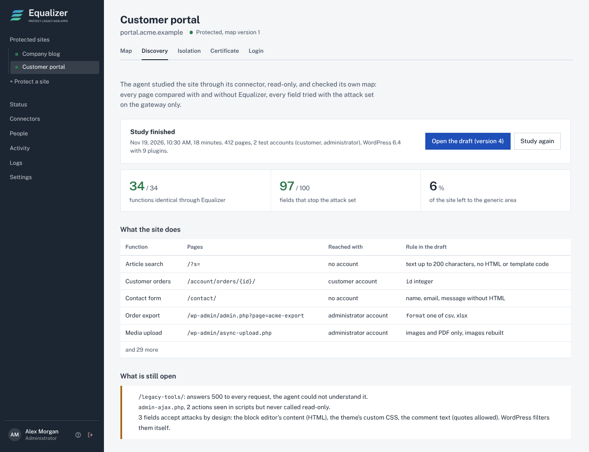
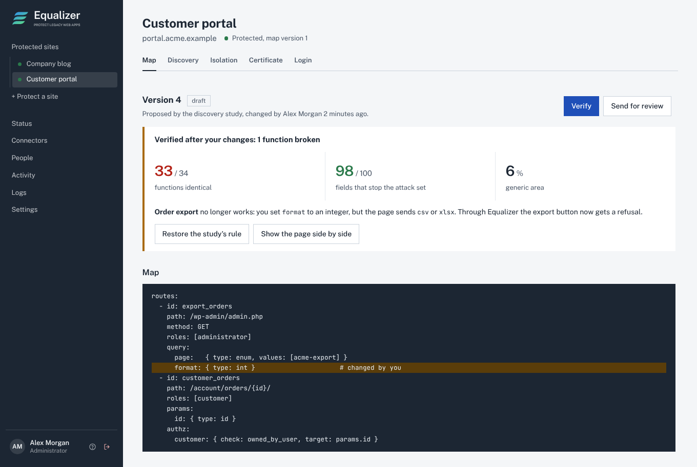

# The agent: studying a legacy site

The agent is what makes Equalizer practical. A gateway that only lets
through what the map declares is as good as its map: a map that is too wide
protects little, a map that is too narrow breaks the site. Writing a tight
and correct map by hand takes days of an expert's time per site, and nobody
does it. The agent does it: it studies the site, writes the map and proves
that the map works, so a person only has to review a result that is already
measured.

This document describes the agent as it is designed. The table in
[Rollout](#rollout) says which parts exist today.

## In one paragraph

The agent opens the site with a real browser, read-only, as a visitor and
with test accounts (administrator included). It learns what each page does,
which values each parameter and field takes, and which accounts use what. It
writes a map with a precise entry for every function it understood, and
leaves to the generic `/` area only what it did not, each with its reason.
Then it checks its own work twice, without ever writing to the legacy site:
every page is compared with and without Equalizer (the site must work the
same), and every parameter and field is tried with a set of attacks against
the gateway alone (the attacks must be refused). Where a check fails, it
widens or narrows that entry and checks again. The draft arrives in the panel
with a score that was measured, not estimated.

## Today and after the study

| | Today | With the study |
| --- | --- | --- |
| Exploration | Follows links and GET forms with plain HTTP requests | A real browser (headless Chrome): scripts run, their AJAX and REST calls are seen |
| Administration | Never opened | Opened read-only with a test administrator (Drupal, Joomla; WordPress writes when its screens are viewed, so it stays closed) |
| Accounts | One optional test account | Up to three (for example customer and administrator), each in its own pass, to reach the pages behind their login |
| Forms | Field names; hidden fields kept on the gateway | Also `type`, `maxlength`, `min`/`max`, `pattern`, `required`, the options of every `<select>` and radio group: tight types without guessing |
| APIs the site declares | Not read | Read: `/wp-json/` (WordPress lists its routes with argument types), Drupal JSON:API, OpenAPI files |
| Map | Precise entries for public pages, everything else in the `/` area | A precise entry for every function understood; the `/` area keeps only what is listed under "still open" |
| Checks | None: a broken page is found by using the site | Every page compared with and without Equalizer; every field tried with the attack set |
| Result | A draft | A draft with a score and the list of what is still open |
| AI | Reviews the structure (masked samples): rename, exclude, narrow | Unchanged (see [AI](#ai)) |

## Web application profiles

What the agent knows about a kind of application lives in one file per
application in `agent/equalizer_agent/webapps/` (WordPress, Joomla,
Drupal, Magento, PrestaShop, OpenCart, TYPO3, Moodle, MediaWiki, phpBB,
and `generic.py` for custom sites). A profile says how to recognise the
application (generator tag, paths, extensions), where a test account logs
in, where its administration is and whether the agent may open it, and
which of its pages act when they are only opened. The rules every site
shares (action links, one-time tokens, sensitive files) are in
`webapps/base.py`, once. The crawler, the map building and the
verification never name an application: they ask the profile of the one
recognised, or the generic one.

A profile opens an administration only when the lab proved that viewing it
changes nothing; until then it stays closed. The
[compatibility matrix](compatibility.md) is generated from the profiles
(`python3 -m equalizer_agent.webapps.matrix`) and the agent's tests fail
when it is stale, so it never says more than the code does.

## How a study runs

### 1. Explore

- **Seeds**: `/`, `robots.txt`, `sitemap.xml`, the template's pages, the
  paths real visitors asked for (reported by the gateway, as today), the
  APIs the site declares.
- **Browser**: headless Chromium (Playwright) inside the agent opens the
  pages each pass found (up to 40 per pass), so their scripts run. Every
  request it makes is intercepted and answered by the agent's own fetcher,
  through the connector like every other request, only when it is a `GET`
  or `HEAD` for the site itself that the crawler's rules allow; everything
  else is refused and listed in the report ("kept in"). The browser's
  network otherwise points at a closed port, so nothing the interception
  does not cover (a WebSocket) gets out. It never clicks, types or submits.
  Requests the scripts make become pages to study like any other; a script
  request answered with JSON stays with the site area and is listed as
  still open (map APIs need their shapes). Without Playwright
  (`EQ_BROWSER=off`) the study runs with plain requests.
- **Passes**: one anonymous, then one per test account. Each pass records
  the pages, the requests the scripts make (with their parameters), the
  forms and their fields, and the links.
- **Limits**: `max_pages`, at most 20 URLs per shape (calendars, searches),
  `EQ_RATE` requests per second, as today.

### 2. Understand

Deterministic, no AI needed:

- **Routes**: varying path segments become typed parameters (`{id}` integer,
  `{slug}`), as today.
- **Values**: every parameter gets the narrowest type that fits all the
  values seen and the form's own attributes: an integer with its range, a
  list of values (`enum`) when the site offers a closed set (a `<select>`,
  links that only ever use `asc` and `desc`), a date, an email, a slug, a
  text with its maximum length.
- **Form fields** (read-only, so from what the page declares, never from
  submitted values): a `<select>`, radio group or checkbox becomes a list of
  values; a number its range; email, date, phone, URL, colour and time
  their formats; an HTML `pattern` is kept when it means the same in the
  gateway's RE2 (no lookaround, at most 1000 repeats).
- **Text fields**: every free-text field refuses HTML and template code
  (`no_html`, `no_template_meta`). A single-line field whose name says it
  holds a name or a code (name, city, zip, phone, code…) also refuses SQL
  delimiters (`no_sql_meta`, an apostrophe between letters stays allowed).
  The others (a search, a message, a nickname) must still accept them and
  are listed under "still open" with the reason.
- **Access stays with the site**: the map does not restrict pages by
  account. Equalizer rebuilds every request and the legacy site keeps
  deciding who sees what (a project decision). The accounts only let the
  agent reach and study the pages behind a login; the report says which
  account reached what.

### 3. Write the map

Precise entries for every function understood. The `/` area stays in the
draft, but every path that still falls into it is listed with its reason
(not reached, answers an error, an action never performed read-only, a value
that cannot be narrowed). The share of the site that still falls into the
area is part of the score.

### 4. Check that the site still works

For every page and every script request seen in step 1:

1. the agent opens it directly through the connector, as in step 1;
2. it asks the gateway to serve it with the **draft** map (preview, below);
3. it compares the two: status, visible text, links and forms (after the
   address rewrite), and a screenshot of both in the browser.

Forms are never submitted. For each form the agent builds the request the
browser would send with the values it saw and asks the gateway, in dry-run,
whether it would accept it.

A difference means the draft is too narrow there: the agent widens that
entry (or gives it back to the area) and checks again.

### 5. Check that attacks are refused

For every parameter and field of the draft, the agent asks the gateway, in
dry-run, whether it would accept each value of a fixed attack set:

- SQL (`' OR 1=1--`, `1;DROP`, comments, stacked queries);
- markup and script (`<script>`, event handlers, `javascript:`);
- template and server code (`{{7*7}}`, `${…}`, `<?php`);
- paths (`../`, encoded variants, null bytes);
- shell (`;`, `|`, `$(…)`, backticks);
- out of type (letters in a number, out-of-range values, oversized values,
  control characters).

A value that would be accepted means the entry is too wide: the agent
narrows it when the values it saw allow it, and checks the site again (step
4). When it cannot narrow without breaking the site, the field is listed
under "still open" with the reason (for example: the post editor accepts
HTML by design).

Nothing in this step reaches the legacy site: a dry-run stops at the gateway.

### 6. Hand over

The draft is saved like any draft, with the report:

- **score**: functions identical through Equalizer (n of total), fields and
  parameters that refuse the whole attack set (n of total), share of the
  site left to the area;
- **what the site does**: each function with its pages, the accounts that
  use it and the rule written for it;
- **still open**: every path left to the area and every field that accepts
  part of the attack set, each with its reason.

A person reviews it, may change it in the editor, presses **Verify** to run
steps 4 and 5 again on their version, and approves. Nothing is ever applied
without approval.

### What a verification measures today

- **Pages**: the pages the latest discovery studied anonymously (the
  version's own literal routes when there is none). Pages behind a login
  are not verified yet: test accounts are erased when a discovery ends.
  A page is identical when the status (or, for a redirect, where it goes),
  the visible text (97% of the words, as dates and counters change between
  two loads; decoded in each answer's own charset), the internal links and
  the number of forms are the same.
- **Inputs**: every query parameter and path parameter of a route that a
  studied page shows how to reach, and every field of a form found on a
  studied page (a valid submission first; if the version refuses it, the
  form is broken). Each gets 20 values in six groups (SQL, HTML and script,
  template and server code, paths, shell, out of type). A value that falls
  out of a route goes to the site area: if the area serves it, the input
  is not protected, which is how the score shows what the area lets
  through.
- **Correcting the draft** (widen where a page broke, narrow where an
  attack passed, verify again) is the next step: today the agent measures
  and reports, and a person changes the draft.

The first verification in the lab found a real bug: on a site served in
plain http, the gateway checked a form's token against the https binding
cookie, so every mapped form submission was refused. Fixed with a
regression test.

## Read-only, guaranteed

The agent never changes the legacy site. Three layers:

1. **No writes leave the agent.** Every request goes through one place
   (`fetch.py`; the browser's requests are answered by it too),
   which refuses every method other than `GET` and `HEAD`, except the login
   of the test accounts (a `POST` to the login form, and to the
   administration's own login where it has one, such as Joomla's). Forms
   are read, never submitted.
2. **No action links, no pages that act when viewed.** Some links change
   something with a plain `GET` (WordPress's "Trash", "Deactivate", "Log
   out"; Joomla checks an article out when its edit form opens). They are
   never opened: generic patterns (verbs such as `delete`, `trash`,
   `publish`, `deactivate`, `logout` as whole words, `action=…`, `task=…`,
   `layout=edit`, links carrying a one-time token such as `_wpnonce` or
   Joomla's form token) and a fixed list of pages that run something when
   opened (scheduled jobs, installers, updates, exports, "add new" screens
   that save a draft). They are listed in the report.
3. **Checks stop at the gateway.** Preview only serves `GET` and `HEAD`;
   everything else is dry-run and never forwarded.

**Proven in the lab** (`lab/e2e/tests/test_06_study.py`): the agent
studies the four lab sites with an administrator account and its browser and the content
of each site's database (pages, articles, comments, users, extensions,
configuration) is the same before and after. Drupal's and Joomla's
administrations are studied this way (Joomla's with its own login).

**WordPress's administration stays closed to the agent**, even with an
administrator account: the lab found that WordPress writes to its database
when its screens are only viewed (the dashboard saves a "Quick Draft", the
theme screens save global styles, the privacy screens save suggested
texts). Its public site and login are studied as before; its
administration stays served by the site area.

What no rule can catch: a custom application that changes data on a plain
link with nothing in its address to say so. For such sites, give the agent a
test account with the fewest permissions possible, or run the study against
a copy of the site.

### Test accounts with few permissions

Fewer permissions mean fewer pages studied (the rest stays in the area), but
a second safety belt. Per CMS:

- **Joomla**: a user group with "Admin Login" and "Access Administration
  Interface" on the components to study, and no Create, Delete, Edit, Edit
  State or Edit Own. This is close to a true read-only administrator.
- **Drupal**: a role with "Use the administration pages and help", "View the
  administration theme" and the "view"/"access … overview" permissions of
  each module. Permissions named "Administer …" also allow changes: leave
  them out, and those pages stay in the area.
- **WordPress**: there is no read-only administrator. A custom role (with a
  role plugin such as Members) can see most screens without editing, but
  settings pages require `manage_options`, which also saves them. Use the
  Editor role for content, or an administrator only on a copy of the site.
- **Custom applications**: depends on the application.

## AI

The study above is deterministic: it does not need an AI model. The tenant's
model keeps its current job: it reviews the structure (paths, parameter
names, masked samples), names entries, excludes what looks like a backup or
an installer, and narrows a type when every observed value fits. It never
opens anything, and its answer is checked field by field.

**Planned, not decided**: letting the model read page contents (text, forms,
scripts) so it understands what each page does and what each field holds,
which gives tighter maps. It would be off by default, enabled by the tenant,
with personal data masked before anything reaches the model, and preferably
with a model on the tenant's own network. Until it is decided, the agent
never sends page contents to a model.

## Contracts

- `schema/api/panel-api.yaml`:
  - `DiscoveryStart.accounts` (up to three test accounts with a label);
  - `DiscoveryJob.accounts`;
  - `StudyReport` (the `report` of a discovery: score, functions, still
    open);
  - `POST /apps/{app}/maps/{version}/verify` and `MapVersion.verification`
    (`Verification`): the **Verify** button;
  - the internal endpoints the agent uses to take and finish a verification.
- `schema/api/gateway-admin.yaml`: the gateway's admin endpoint (internal
  network only), now documented, with the new `POST /maps/try`:
  - `dry_run`: would the gateway accept this request with the draft, and if
    not which field and why; nothing is forwarded;
  - `preview` (`GET` and `HEAD` only): the gateway serves the request with
    the draft, through the connector, and returns the rebuilt answer;
  - the draft must be signed by panel-api for this purpose with a short
    expiry, and the call needs the service token, so only a version the
    panel handed to the agent can be tried, and only towards its own
    tenant's connector;
  - for test accounts, the agent logs in to the legacy site itself and
    hands the legacy cookies over; the gateway opens a try session with
    them and the account's role, and returns its cookie for the next tries;
  - tries use no rate limits (the attack set measures the map, not the
    limits), their events stay in the answer (an attack set never reaches
    the security logs), and a dry-run never changes a session.

## Rollout

Each step is its own pull request, tested in the lab before the next.

| Step | What | Status |
| --- | --- | --- |
| 1 | This document and the contracts | Done |
| 2 | Gateway: `POST /maps/try` (preview and dry-run); panel-api: signing for tries | Done |
| 3a | Agent: several accounts, form fields typed from their HTML, text rules, "still open" in the report; panel: accounts | Done |
| 3b | Agent: administration read-only (Drupal, Joomla; not WordPress), single read-only guard, a lab study of the four sites proving nothing changes | Done |
| 3c | Agent: browser (Playwright) behind the read-only guard, script requests; Chromium in the agent image | Done |
| 4 | Agent: the two checks and the score; panel-api verification queue (every draft a discovery proposes is verified) | Done: measures; the agent does not yet correct its own draft |
| 5 | Panel: score, broken pages and "still open" on the version and in the discovery report, Verify button | Done |
| 6 | Lab: studies of WordPress, Joomla, Drupal and the intranet with the expected scores | Planned |

## Mockups

How the panel will show a study (fictitious company Acme; not built yet).

The Discovery tab after a study: the score, what the site does with the rule
written for each function, and what is still open with its reason.

A draft changed by hand and verified again: the change broke one function,
and the panel says which and why.

