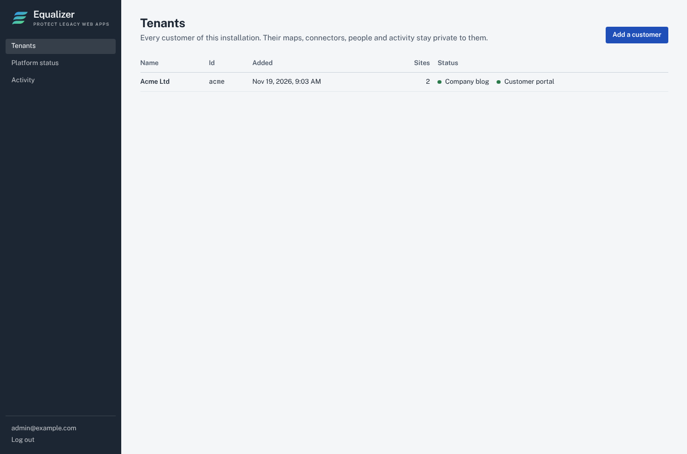
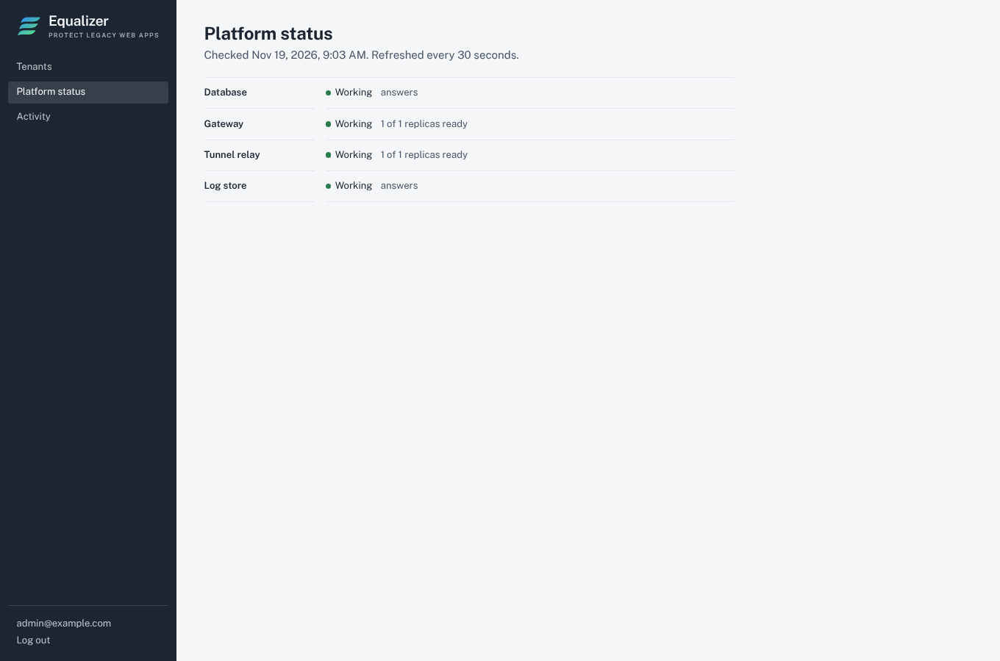

# Platform administrator manual

For whoever runs an Equalizer installation: tenants, platform health,
logs and routine procedures.

> This manual describes what the panel does today. What is not available
> yet is listed at the end. Screenshots use a fictitious company, Acme.

## 1. Access

- The panel answers on `EQ_PANEL_DOMAIN` (customers log in there) and on
  the VPS localhost, port 8088 (over an SSH tunnel or a VPN).
- The first platform administrator is created on the server with
  `panel-api create-admin -email … -name …` (see `INSTALL.md`); an
  authenticator app is mandatory.
- Platform users see **Tenants**, **Platform status** and **Activity**.

## 2. Tenants

1. **Tenants → Add a customer**: name, id, name and email of the tenant's
   first administrator.
2. The administrator receives an email with a link (single use, 48 hours),
   chooses a password and sets up an authenticator app; then protects sites
   and invites colleagues.
3. Until someone joins, the tenant shows **Waiting for the administrator to
   join** with **Invite again** (email lost or wrong address): the previous
   link stops working. Once anyone has joined, only the tenant's
   administrators invite people.

**Privacy**: the platform sees each tenant's name and, per site, only its
name and status (protected, being set up, exposed). Maps, connectors,
people, logs, the status of each site and the tenant's activity are visible
only to the tenant's people. The platform's Activity page lists platform
actions only.

## 3. Platform status

The first page to check: whether the database, every gateway and relay
replica and the log store answer. Refreshed every 30 seconds; it shows no
tenant data.

| Service | Down means |
| --- | --- |
| Database | The panel cannot work; gateways keep serving the last maps |
| Gateway | No replica ready: protected sites do not answer |
| Tunnel relay | Sites reached through connectors do not answer |
| Log store | The tenants' Logs page and the traffic on their Status page are unavailable |

## 4. Logs

The platform's logs are in **Grafana** (`127.0.0.1:3000` on the VPS, over
an SSH tunnel): Loki keeps the `security` stream (gateway events) and the
`application` stream (service logs) for 30 days. Each tenant reads its own
security events in the panel (**Logs**); the platform does not read them in
the panel.

## 5. Routine procedures

| Situation | What to do |
| --- | --- |
| A replica not ready | `docker compose ps`, then the service's logs in Grafana (`{service="gateway"}`) |
| A tenant says its site is down | Ask them to open **Status**: it says whether the connector, the legacy site or the map is the cause |
| Connector offline for a tenant | The connector machine or its network: the tenant restarts it (`INSTALL.md`, section 7) |
| Certificate missing for a domain | The domain must point to the VPS and have a published map (`/tls/allowed`) |
| Exposure on a tenant's site | Their legacy site answers on its old IP: they must close it (Site → Isolation) |
| Update | Check out the new release tag, set `EQ_VERSION`, `docker compose up -d --build`, then update the connectors (`INSTALL.md`, section 9) |

## 6. Not available yet

- Plans and limits per tenant; capacity and pools from the panel.
- Log levels and request tracing from the panel.
- Forwarding to a SIEM (syslog, Splunk HEC, Sentinel, webhook).
- Platform import and export (individual maps can already be exported and
  imported by tenants).
- Login to the platform only from a VPN.
