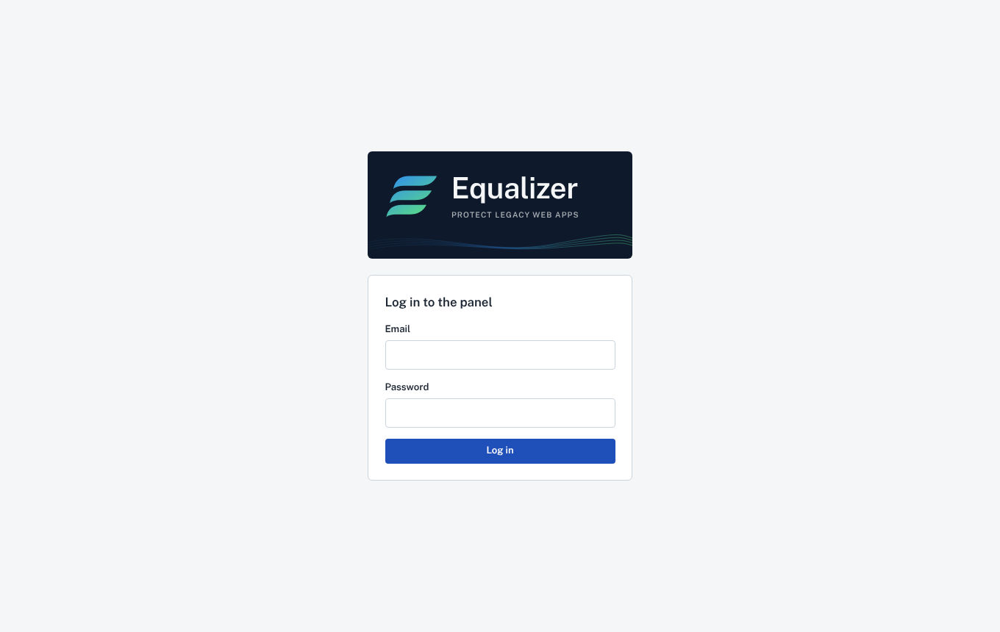

# Equalizer guide for platform administrators

For whoever runs an Equalizer installation: customers (tenants), platform
health, settings and routine procedures. The same guide opens in the panel
under **Help**. Installation is in `INSTALL.md`. Screenshots use a
fictitious company, Acme.

## Getting started

### Access

- The panel answers on `EQ_PANEL_DOMAIN` (customers log in there) and on
  the VPS localhost, port 8088 (over an SSH tunnel or a VPN).
- An authenticator app is mandatory: the first login links it and shows ten
  recovery codes once.
- Platform users see **Tenants**, **Platform status**, **Activity**; at the
  bottom of the sidebar their name and role (their account), **Help**
  (question mark) and **Log out**.



### The first administrator

Created on the server, never from the panel:

```bash
docker compose run --rm -i panel-api create-admin -email you@example.com -name "Your Name"
```

Type the password (at least 12 characters) and press Enter.

### Platform roles

- **Platform administrator** and **operator**: run the installation and
  manage tenants.
- They hold no role inside a tenant: maps, connectors, people, logs and the
  tenant's activity stay closed to them.

## Tenants

### Add a customer


1. **Tenants → Add a customer**: name, id, name and email of the tenant's
   first administrator.
2. The administrator receives an email with a link (single use, 48 hours),
   chooses a password and sets up an authenticator app; then protects sites
   and invites colleagues.

### Invitations

Until someone joins, the tenant shows **Waiting for the administrator to
join** with **Invite again** (email lost or wrong address): the previous
link stops working. Once anyone has joined, only the tenant's
administrators invite people.

### Privacy

The platform sees each tenant's name and, per site, only its name and
status (protected, being set up, exposed). Maps, connectors, people, logs,
the status of each site and the tenant's activity are visible only to the
tenant's people. The platform's **Activity** page lists platform actions
only.

## Platform status

### What it shows

The first page to check: whether the database, every gateway and relay
replica and the log store answer. Refreshed every 30 seconds; it shows no
tenant data.


### When a service is down

| Service | Down means |
| --- | --- |
| Database | The panel cannot work; gateways keep serving the last maps |
| Gateway | No replica ready: protected sites do not answer |
| Tunnel relay | Sites reached through connectors do not answer |
| Log store | The tenants' Logs page and the traffic on their Status page are unavailable |

## Logs

### Grafana

The platform's logs are in **Grafana** (`127.0.0.1:3000` on the VPS, over
an SSH tunnel: `ssh -L 3000:localhost:3000 user@vps`). Loki keeps the
`security` stream (gateway events) and the `application` stream (service
logs) for 30 days. Useful queries:

```text
{service="gateway"}                          all gateway logs
{service="gateway", stream="security"}       security events only
{service="gateway"} |= "r-4ffd4c18cbf386ec"  one request
{service="gateway", level="error"}           errors only
```

### Tenants' logs

Each tenant reads its own security events in the panel (**Logs**); the
platform does not read them in the panel.

## Settings

### Main values in .env

| Variable | Meaning |
| --- | --- |
| `EQ_VERSION` | Release installed |
| `EQ_PANEL_DOMAIN`, `EQ_RELAY_DOMAIN` | Public domains of the panel and of the relay |
| `EQ_GATEWAY_REPLICAS` | Gateway replicas |
| `EQ_TRUSTED_PROXIES` | Networks allowed to state the client IP (Caddy's, and panel-ui's for the panel): the gateway's rate limits and the panel's login limits and audit use the visitor's address |
| `EQ_BEHIND_CLOUDFLARE` | `true` only when protected sites are reachable through Cloudflare alone: the IP is read from `CF-Connecting-IP` |
| `EQ_DIRECT_DESTINATIONS` | Lab only: destinations a map may reach without a connector |
| `EQ_EXPOSURE_INTERVAL` | How often protected sites are checked on their old IP |
| `EQ_LOG_LEVEL` | `debug`, `info`, `warn`, `error` |

Change a value, then `docker compose up -d`. The full list is in
`INSTALL.md`.

### Secrets

Keys and tokens live in `deploy/compose/secrets/`, created with `eqtool`
(`INSTALL.md`, section 5): map signing key, form key, relay and internal
tokens, database password, authenticator key. Never commit them.

## Routine procedures

### Backup and restore

`deploy/compose/backup.sh` saves the panel database, the secrets and
`.env` in one archive (encrypted with `EQ_BACKUP_PASSPHRASE`); run it every
night from cron and copy the archives off the VPS. `restore.sh` puts an
archive back, on the same VPS or a new one (`INSTALL.md`, section 10).

### Common situations

| Situation | What to do |
| --- | --- |
| A replica not ready | `docker compose ps`, then the service's logs in Grafana (`{service="gateway"}`) |
| A tenant says its site is down | Ask them to open **Status**: it says whether the connector, the legacy site or the map is the cause |
| Connector offline for a tenant | The connector machine or its network: the tenant restarts it (`INSTALL.md`, section 7) |
| Certificate missing for a domain | The domain must point to the VPS and have a published map (`/tls/allowed`) |
| Exposure on a tenant's site | Their legacy site answers on its old IP: they must close it (Site → Isolation) |
| Someone forgot the password | **Forgot your password?** on the login page (needs the mail server); a lost authenticator is reset by their administrator; platform users use one of their recovery codes |
| Customers get no alerts or links | The mail server: `EQ_SMTP_ADDR`; without it nothing is emailed |

### Update

1. `git fetch --tags` and `git checkout` the new release tag.
2. Set `EQ_VERSION` in `.env`.
3. `docker compose pull` and `docker compose up -d --build`: database
   migrations run on their own.
4. Tell tenants to update their connectors to the same release: their
   Connectors and Status pages mark the older ones.

### Checks after a change

| Check | How |
| --- | --- |
| Services running | `docker compose ps`; **Platform status**: everything "Working" |
| A site end to end | Open its domain: the page answers; the tenant's **Logs** shows it as served |
| Exposure | The legacy application does not answer from the Internet |

## Not available yet

### Planned

- Plans and limits per tenant; capacity and pools from the panel.
- Log levels and request tracing from the panel.
- Forwarding to a SIEM (syslog, Splunk HEC, Sentinel, webhook).
- Platform import and export (individual maps can already be exported and
  imported by tenants).
- Login to the platform only from a VPN.
- Support access to a tenant, granted and limited in time by the tenant.
