# Tenant administrator manual

For whoever protects their own sites with Equalizer: adding a site, the
connector, the map, approval, isolation and day-to-day use.

> This manual describes what the panel does today. What is not available
> yet is listed at the end. Screenshots use a fictitious company, Acme.

## 1. The panel

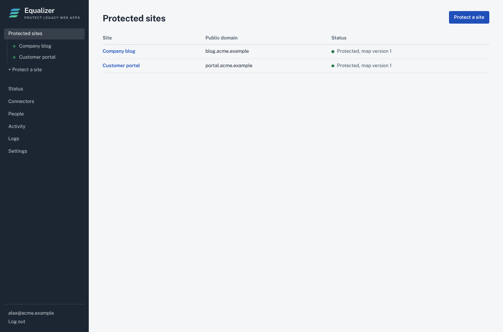

- **Protected sites**: your sites, each with a dot (green protected, grey
  being set up, red exposed), and **+ Protect a site**.
- **Status**, **Connectors**, **People**, **Activity**, **Logs**,
  **Settings**: some pages depend on your role.
- A site has three tabs: **Map**, **Discovery**, **Isolation**.

Tenant roles: **administrator** (everything), **editor** (writes maps),
**approver** (approves and publishes), **auditor** (reads). Whoever writes a
version cannot approve it.

| Page | Administrator | Editor | Approver | Auditor |
| --- | --- | --- | --- | --- |
| Sites, Status, People | yes | yes | yes | yes |
| Connectors, Settings, Isolation | yes | | | |
| Activity | yes | | yes | yes |
| Map: write drafts, import | yes | yes | | |
| Map: approve, publish, roll back | yes | | yes | |
| Login: settings (as a draft) / client secret | yes / yes | yes / | | |
| Logs | yes | | yes | yes |

### Joining and inviting

The first administrator receives an email from the platform with a link to
choose a password and set up an authenticator app. Then **People → Invite a
person** (name, email, role): the link works once and expires in 48 hours;
pending invitations can be revoked.

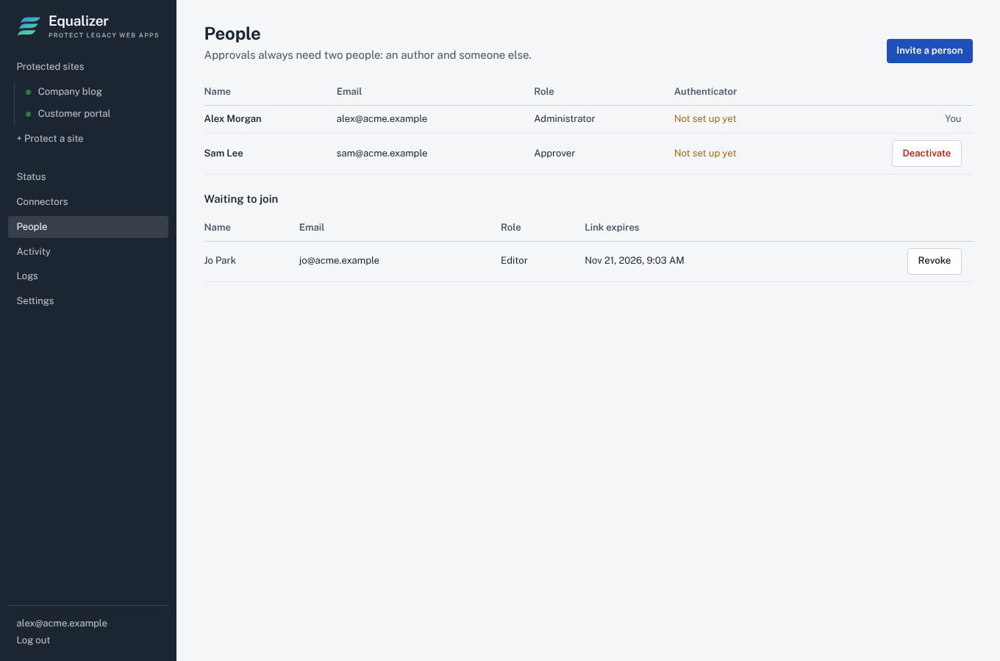

### Privacy

The platform operator sees your tenant's name and, per site, its name and
status (protected or being set up). Nothing else: not your maps, connectors,
people, logs or activity.

## 2. Protecting a site

The original site keeps working as it is during the whole procedure.

### Step 1 — The site

**+ Protect a site**: name, public domain (e.g. `portal.acme.example`) and
what it is built with (WordPress, Joomla, Drupal, Moodle or another site).
The choice lets the first map start from a template.

### Step 2 — The connector

One connector per server: it serves every site on that server.
**Connectors → Add a connector** gives a token, shown once, and the command
to run on the server (Docker or a binary, see `INSTALL.md`). The connector
only opens an outbound HTTPS connection: no inbound port. Its `EQ_ALLOW`
lists the addresses it may reach; nothing else is reachable through it,
whatever it is asked.

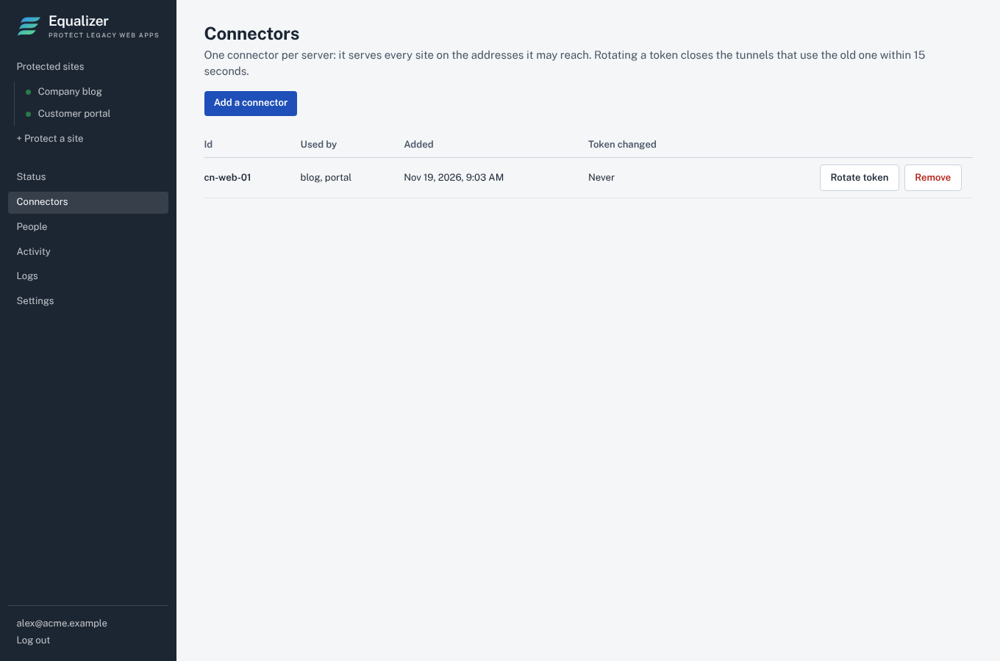

### Step 3 — The first map

**Site → Map → New version**:

- **Start from a template**: choose the connector and the address of the
  site on the server; the editor fills with the pages, files and forms of
  that CMS. The whole site works at once, admin included. **Max upload
  (MB)** is the largest file the site accepts (default 50, at most 1024).
- **Import a map file**: a YAML or JSON map exported from another site.
- Or write it in the editor (format in `docs/map-format.md`).

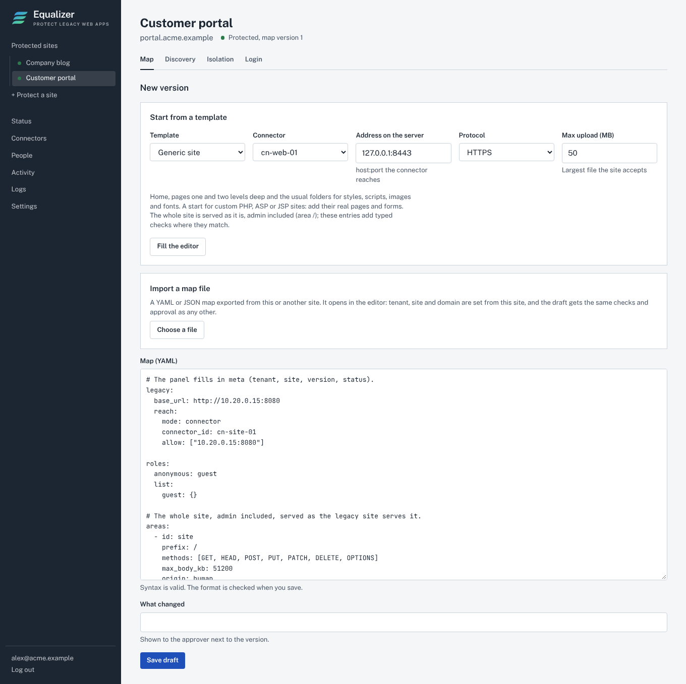

**Save draft** checks the format, that the connector is yours and the
address is allowed. Then **Send for review**.

### Step 4 — Discovery

**Site → Discovery → Start discovery**. The agent explores the site through
the connector, never from the Internet, does not open admin pages and follows no
link that changes something. With a test account it also explores as a
logged-in user (the password is encrypted and deleted at the end).

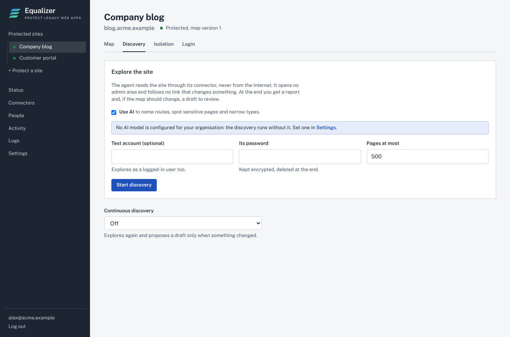

The whole site always stays in the map through the `/` area. The report
shows what was found, which pages got precise entries, what the agent did
not open (still served by the area), what visitors
asked for that the map lacks, and the protection against IDOR it proposes
for JSON APIs (a list and a detail with the same id). If the map should
change, a draft is proposed: review it and send it for approval.
**Continuous discovery** (every day or week) explores again and proposes a
draft only when something changed.

**Settings → AI**: your own model (Claude, OpenAI or your own server) names
routes, spots sensitive pages and narrows types. The key is yours, encrypted
and never shown again. Without a model discovery still works.

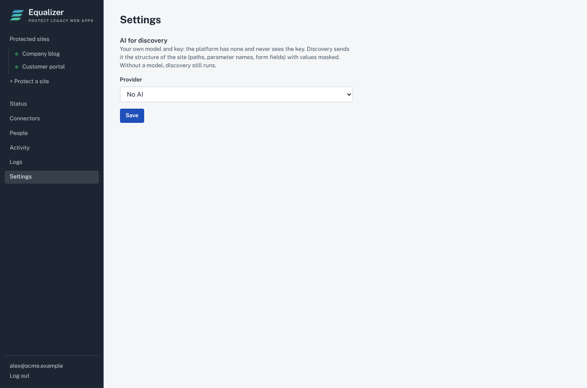

### Step 5 — Review and approval

Each version shows what it changes against the published map and the risks
found by fixed rules (a type widened, an admin or backup path, a page with
personal data and no authorisation rule, an answer that grants access to
more objects…). With an AI model a summary and the questions to ask appear
too. Approving stays a person's decision.

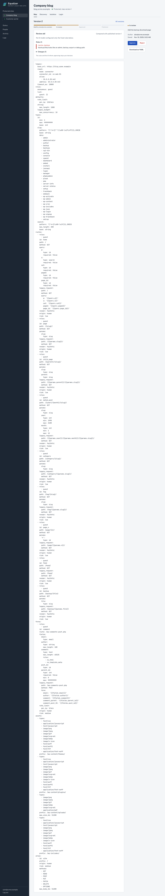

**Approve**, then **Publish**: the gateways load the signed map within 15
seconds. Every version can be downloaded with **Download as YAML**.

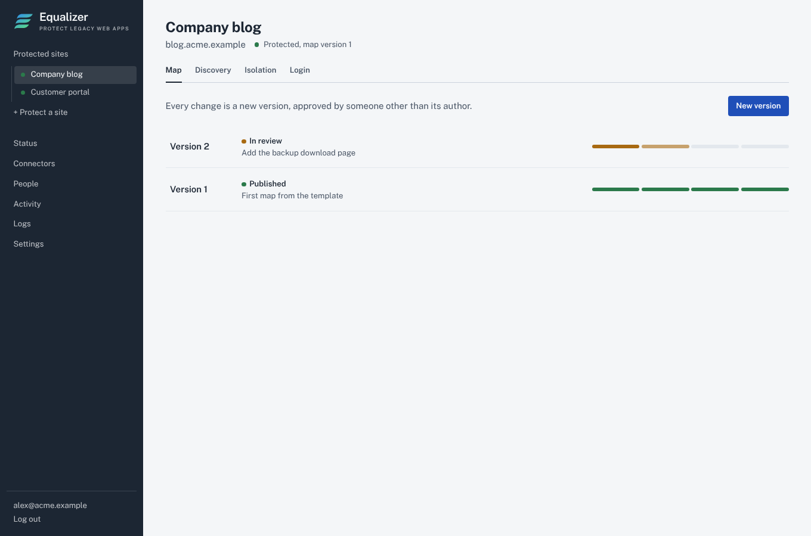

### Step 6 — Point the domain and isolate the site

1. Point the site's DNS record to the platform (the address is given by the
   platform operator). The certificate is issued automatically.
2. **Site → Isolation**: enter the old public IP of the site. Equalizer
   checks regularly that the site no longer answers there, and gives the
   lines to copy for Apache, nginx or IIS: move the site to an internal
   address, or let only the connector in. The other sites on the server stay
   as they are.

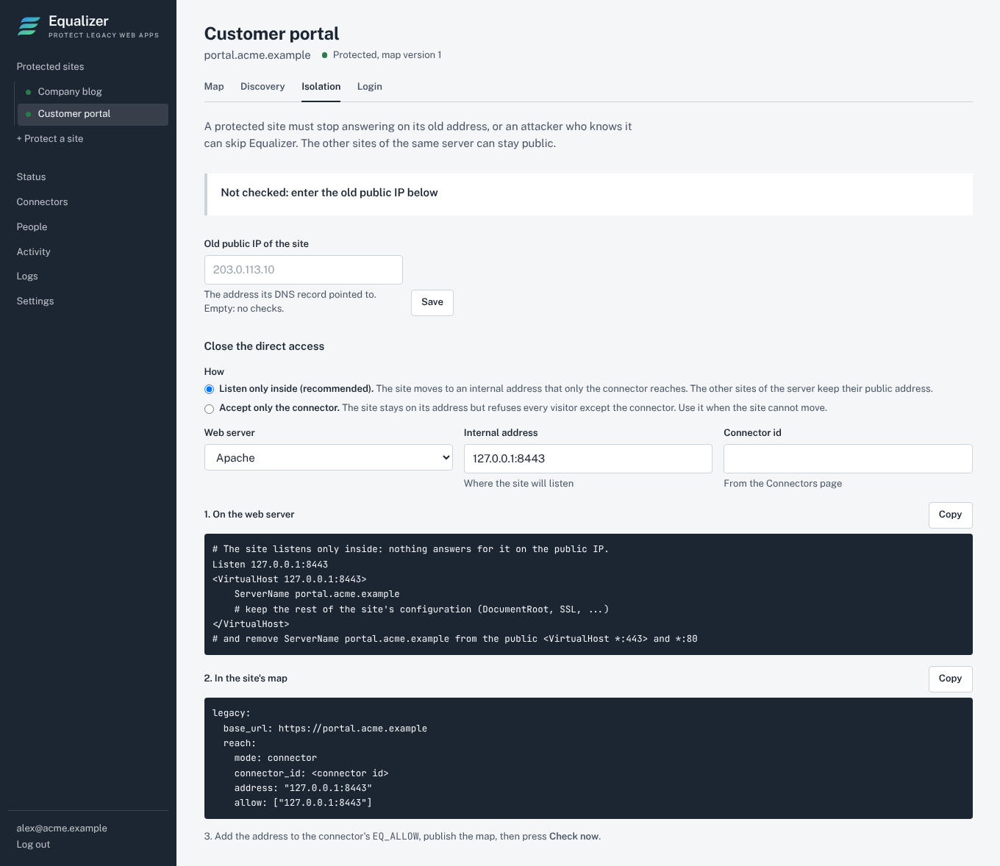

### Optional — Login with your identity provider

Off by default. **Site → Login** turns on the login with your
organisation's identity provider (Entra ID, Google, Okta, Keycloak…) before
the site: issuer, client ID, and which group of your provider gets which
role of the map. **Save as new draft** writes a new version that follows
the usual review and approval. In your provider register the redirect URI
shown on the page, and save the client secret there (administrators only;
encrypted, never shown again).

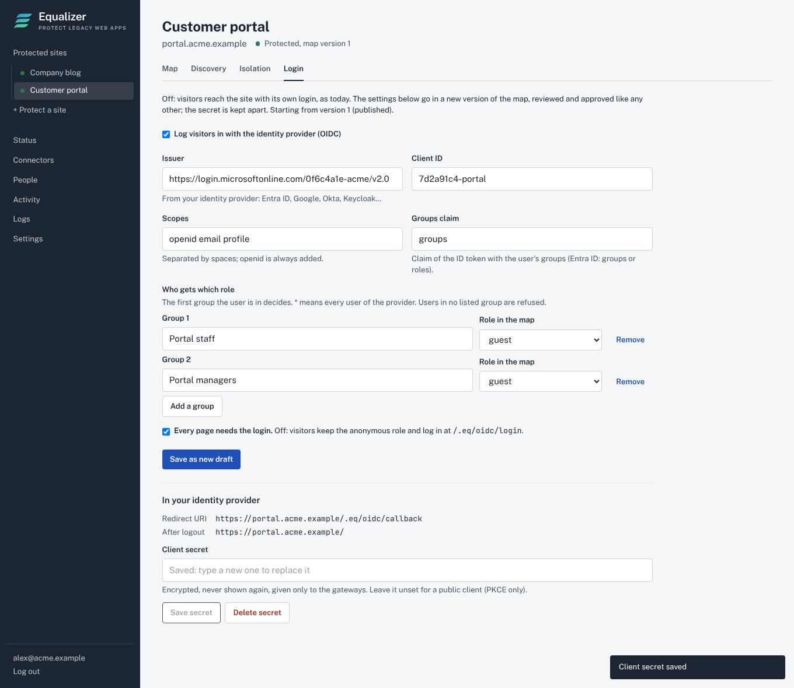

If a protected site becomes reachable again on its old IP, it turns red on
the Status page and in Activity.

## 3. Day-to-day use

### Status

Whether each site works, and which part is broken: published map,
connector, legacy site (errors in the last 15 minutes), isolation, and the
last 7 days. Refreshed every 30 seconds.

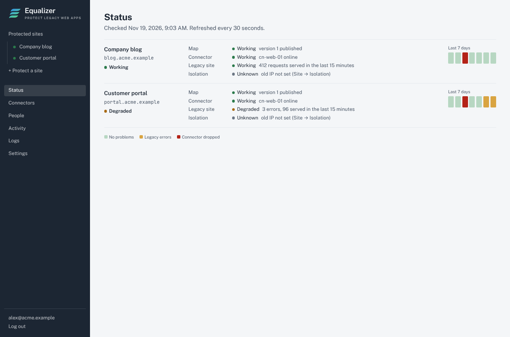

### Logs

What the gateway served and refused on your sites, for 30 days: filters by
site, period, kind of event and free search (IP address, path, request ID).
A row opens its detail in plain words; on a path that is not in the map,
**Add to the map** opens a new version. **Live** refreshes every few
seconds; **Export CSV** downloads up to 10 000 events (recorded in
Activity). Field values are never stored, only the field name and the rule
that refused it. The IP address is the visitor's real one, the same the
legacy site receives in `X-Forwarded-For` (its own logs and bans keep
working).

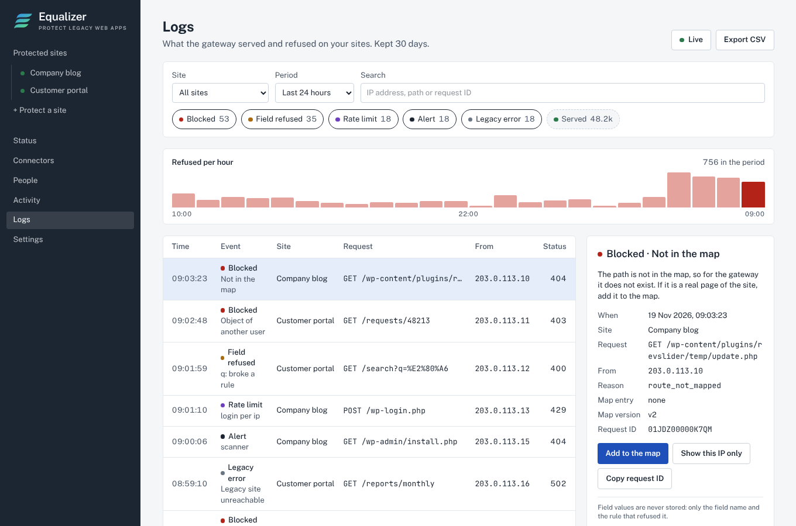

### Activity

Who did what: logins, invitations, maps written, approved, published, rolled
back, exports.

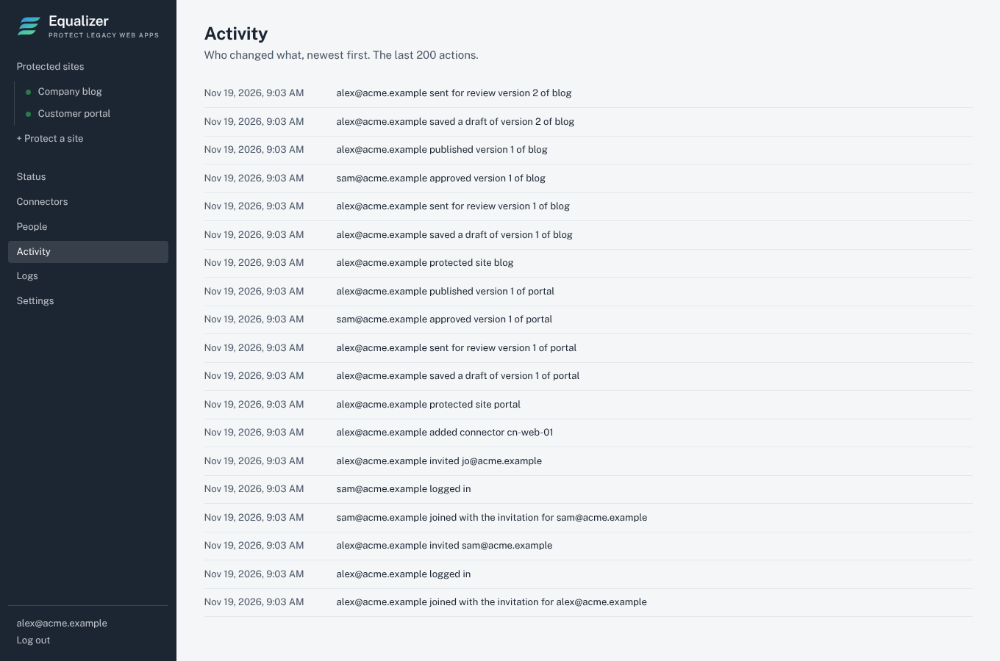

### Rollback

If a new version breaks the site, open the previous version and **Roll back
to this version**: it is live again within 15 seconds.

## 4. What the map protects

- **The whole site works as before**, admin included, with its logins,
  "remember me", uploads (up to the size chosen in the template), live
  updates and mobile version. Equalizer does not
  decide who may do what, the legacy site does. It removes the direct
  contact with the legacy server and rebuilds every request (path, query,
  forms, JSON, XML; malformed requests, XML entities and unknown binary
  bodies never reach it).
- **Typed fields** where the map has precise entries (templates and
  discovery add them): no SQL or HTML characters where not expected, sealed
  forms, rate limits and behaviour rules against brute force and scanners.
- **Authorisation** (`owned_by_user`): each user opens only the objects the
  site showed them, in its pages, redirects or JSON answers; changing the
  number in the address gives 403.
- **Uploads**: real type read from the bytes, size limit, random name,
  images rebuilt from their pixels. Equalizer does not scan for viruses:
  keep your antivirus or EDR on the legacy server.

## 5. Not available yet

- Forwarding to your SIEM (Splunk, Sentinel, syslog).
- Capacity settings (replicas, cache) from the panel.
- Single sign-on to the panel itself, and one legacy account per user behind
  the identity provider login.
- Alerts for known vulnerabilities of the detected CMS version.
